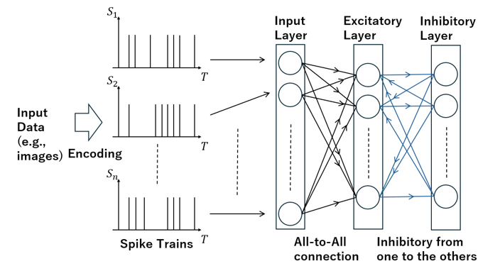

# PICO SNN
This repository contains SNN codes for Raspberry Pi Pico. The model is based on unsupervised learning single layer feedforward SNN, with inhibitory signal. LIF is incorporated for neuron model.


## Tile classification (4x4)
```
python3 tiny_snn_pico_4x4.py
```
```
[1 0 0 0 0 1 0 0 0 0 1 0 0 0 0 1]
prediction: 0
correct

[0 0 0 1 0 0 1 0 0 1 0 0 1 0 0 0]
prediction: 1
correct

[0 0 0 1 0 0 0 1 0 0 0 1 0 0 0 1]
prediction: 2
correct

Accuracy: 100.0 %
```

## Irisdataset (https://www.kaggle.com/datasets/uciml/iris)
*iris.csv is already in the repository. The program runs without downloading.
```
python3 tiny_snn_pico_iris.py
```
```
...
prediction: Iris-virginica
correct

Accuracy: 64.44444444444444 %

```

## Handwritten digits (custom)
```
python3 tiny_snn_pico_handwritten.py
```
```
```